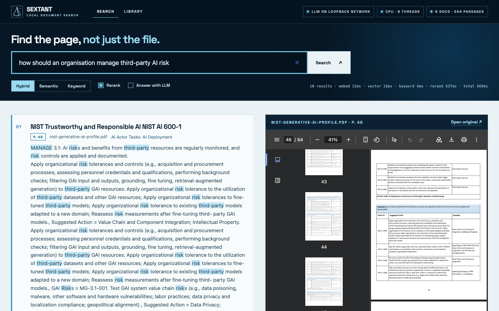
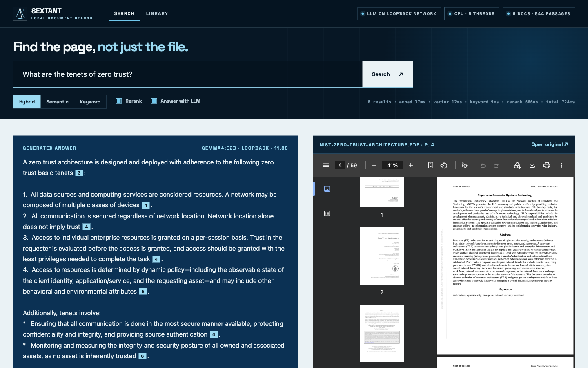

# Sextant

**Local-first document search that runs on the CPU you already have, with no network connection.**

Point Sextant at a folder of PDFs, Word files, slides and spreadsheets. It parses them with
[Docling](https://github.com/docling-project/docling), indexes every passage for both keyword
and semantic search, and gives you a web interface where each result opens the source document
at the matching page. Nothing leaves the machine. An LLM is optional, and off by default.



A sextant fixes your position without any outside signal. That is the design brief.

- **Air-gapped by construction.** One command (`sextant models pull`) uses the network. Every
  other command forces the model libraries offline, so a missing model is a clear local error,
  never a silent download.
- **CPU-only.** Parsing, embedding and reranking all run on ordinary processors. No GPU, no
  CUDA, no drivers.
- **Hybrid retrieval.** BM25 keyword search and dense vector search run side by side, are fused
  by reciprocal rank, and the best candidates are reranked by a cross-encoder. Exact part
  numbers and loosely worded questions both work.
- **Every answer has an address.** Results carry the file, page and section they came from.
- **Optional intelligence.** Connect any OpenAI-compatible endpoint (Ollama, llama.cpp, vLLM,
  or a hosted provider) to get cited answers. Sextant tells you whether that endpoint is on
  this machine, on your network, or external.
- **Small and readable.** About 1,700 lines of Python and a dependency-free web page. No
  server database, no message queue, no build step.

## Quick start

Requirements: Python 3.11–3.13, [uv](https://docs.astral.sh/uv/), about 2.5 GB of disk
(dependencies and models) and 4 GB of free memory. Developed and tested on macOS (Apple
Silicon); Linux and Windows use the same code path.

```bash
git clone https://github.com/b4ked/sextant.git
cd sextant
uv sync                                   # install (CPU-only wheels)
uv run sextant models pull                # one-time download, ~900 MB — the only online step
./scripts/fetch-sample-corpus.sh          # optional: six public PDFs (NIST frameworks, two papers)
uv run sextant index sample-corpus        # or any folder of your own
uv run sextant serve                      # http://127.0.0.1:8321
```

Prefer pip? `python -m venv .venv && . .venv/bin/activate && pip install -e .`
(on Linux add `--extra-index-url https://download.pytorch.org/whl/cpu` to avoid CUDA wheels).

Search from the terminal too:

```console
$ uv run sextant search "PR.AA-05" -k 1
 1 nist-cybersecurity-framework-2.0.pdf · p.25  vec#2 bm25#1 rerank 1.00
   PROTECT (PR): Safeguards to manage the organization's cybersecurity risks are used
   - o PR.AA-05: Access permissions, entitlements, and authorizations are defined in a
   policy, managed, enforced, and reviewed, and incorporate the principles of least …
```

## How it works

```
 folder ──▶ Docling ──▶ structure-aware ──▶ bge-small ──▶ LanceDB  (vectors + BM25 index)
            (layout,     chunker             embeddings     SQLite   (document catalogue)
             tables,     (≤384 tokens,       (ONNX, CPU)
             OCR opt.)    heading context)

 query ──▶ BM25 top 50 ───┐
       └─▶ vector top 50 ─┴─▶ reciprocal rank fusion ──▶ cross-encoder rerank (top 20) ──▶ results with
                                                                                            file, page, section
                                                                                            └─▶ optional LLM ──▶ cited answer
```

| Stage | Component | Why |
|---|---|---|
| Parsing | Docling (layout model + TableFormer, optional RapidOCR) | Recovers reading order, headings, tables and page numbers instead of a flat text dump |
| Chunking | Docling `HybridChunker`, sized with the embedding model's own tokenizer | Passages follow document structure and carry their heading path |
| Embeddings | `BAAI/bge-small-en-v1.5`, 384-dim, quantised ONNX (67 MB) | Fast on CPU, MIT-licensed, widely used |
| Storage | LanceDB (embedded) + SQLite | One directory on disk. No database server to run, patch or secure |
| Keyword search | LanceDB native BM25 index | Exact identifiers, names, codes |
| Fusion | Reciprocal rank fusion, k = 60 | Combines rankings without tuning score scales |
| Reranking | `ms-marco-MiniLM-L-6-v2` cross-encoder (ONNX) | Reads query and passage together |
| Interface | FastAPI + one static page (no CDN, no external fonts) | Works with the network cable unplugged; a strict Content-Security-Policy enforces it |

More detail: [docs/architecture.md](docs/architecture.md).

## Measured, not promised

One run on an Apple M3 laptop (8 cores, 16 GB), inference device forced to `cpu`:

| | |
|---|---|
| Corpus | 6 PDFs, 227 pages, 12.8 MB |
| Indexing | 132 s end to end, about 1.7 pages per second, 544 passages |
| Peak memory while indexing | 3.3 GB |
| Index size on disk | 3.7 MB |
| Query, hybrid without rerank | about 15 ms |
| Query, hybrid with rerank | about 0.6–0.7 s |
| Re-index with nothing changed | under 1 s |

These are timings from one machine and one small corpus, not a benchmark. Retrieval quality has
been checked with the test suite and by hand, not against a labelled evaluation set. Run it on
your own documents before you rely on it.

## Proving the air gap

```bash
uv run sextant doctor                               # models present, libraries offline, egress status
./scripts/verify-airgap-macos.sh sample-corpus      # macOS: index + search with outbound network denied
unshare -rn uv run sextant index sample-corpus      # Linux: same idea, empty network namespace
```

To deploy on a machine that has never been online, run `sextant models pull` elsewhere and copy
`~/.sextant/models` across. See [docs/air-gapped.md](docs/air-gapped.md).

## Docker

```bash
docker build -t sextant .
docker run --rm -v sextant-home:/data sextant models pull                      # online, once
docker run --rm --network none -v sextant-home:/data -v /path/to/docs:/docs:ro \
    sextant index /docs                                                        # no network at all
docker run --rm -p 127.0.0.1:8321:8321 -v sextant-home:/data -v /path/to/docs:/docs:ro sextant
```

The image is CPU-only (about 3 GB; no CUDA libraries) and runs as a non-root user. Indexing
and search have been run in it with `--network none`.

## Adding an LLM (optional)

```bash
export SEXTANT_LLM_BASE_URL=http://localhost:11434/v1   # Ollama; any OpenAI-compatible URL works
export SEXTANT_LLM_MODEL=gemma4:e2b
uv run sextant ask "What are the tenets of zero trust?"
```



The web interface gains an **Answer with LLM** switch and a status chip showing where prompts
go: loopback, private network, or external. Retrieval stays local either way; only the handful
of retrieved passages are sent to the model. See [docs/llm.md](docs/llm.md).

## Commands

| Command | Does |
|---|---|
| `sextant models pull` / `models status` | Download or list local models |
| `sextant index <folder> [--ocr] [--force] [--quiet]` | Index new and changed files; drop deleted ones |
| `sextant search "<query>" [-k N] [--mode hybrid\|semantic\|keyword] [--json]` | Search from the terminal |
| `sextant ask "<question>"` | Cited answer from the configured LLM |
| `sextant serve [--host] [--port]` | Web interface and JSON API |
| `sextant status` / `doctor` / `reset` | Inspect the index, check offline readiness, delete the index |

Formats: PDF, DOCX, PPTX, XLSX, HTML, Markdown, CSV, AsciiDoc, plain text; scanned PDFs and
images with `--ocr`. Settings: [docs/configuration.md](docs/configuration.md).

## What the engine deliberately leaves out

Sextant is a single-user engine bound to `127.0.0.1`. It has **no authentication, no
per-document permissions and no multi-tenant isolation**. Those belong to the deployment around
it, and getting them wrong is how internal search tools leak documents.

| In this repository (Apache-2.0) | Deployment work, done per organisation |
|---|---|
| Parsing, chunking, embedding, hybrid search, reranking | Single sign-on and per-user, per-folder access control |
| Web interface and JSON API | Connectors and scheduled indexing for file shares, SharePoint, a DMS |
| Incremental indexing, OCR | Multi-user serving, TLS, audit logging, backups, monitoring |
| Optional LLM connector | Sizing and hosting a local LLM; evaluation on your own documents |

[Parry Technologies](https://parrytech.co) builds that outer layer on an organisation's own
infrastructure. [docs/deployment.md](docs/deployment.md) describes how far the open engine goes
on its own (including cron and systemd examples) and where the service starts. To talk about a
deployment: [parryh@parrytech.co](mailto:parryh@parrytech.co).

## Development

```bash
uv sync
uv run pytest          # end-to-end tests use the real models if they are pulled
uv run ruff check src tests
```

## Licence

Apache-2.0. See [LICENSE](LICENSE) and [NOTICE](NOTICE). Models are downloaded on request and
governed by their own licences.
